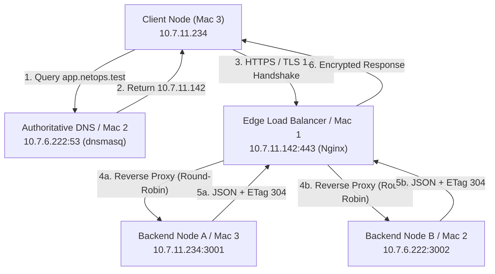

# NetOps — Enterprise Distributed Networking & Edge Infrastructure

A multi-node computer networks demonstration illustrating core Internet architecture protocols, edge proxying, split-horizon DNS resolution, transport layer security (TLS 1.3), load balancing algorithms, HTTP/1.1 conditional caching, and deep packet inspection using Wireshark across physical machines.

---

## 1. System Topology & Network Architecture

The deployment spans three independent physical nodes interconnected via a dedicated local subnet:

```text
                    Client / Mac 3
                         │
                         │ DNS
                         ▼
                  Mac 2 — dnsmasq
                    10.7.6.222
                       :53
                         │
                         │ app.netops.test
                         ▼
                  Mac 1 — Nginx
                   10.7.11.142
                       :443
                         │
                 ┌───────┴───────┐
                 ▼               ▼
          Backend A          Backend B
        10.7.11.234        10.7.6.222
            :3001               :3002
```

### Architectural Flowchart (Mermaid)



---

## 2. Repository Layout & File Architecture

```text
.
├── Architecture.pdf              # System topology diagrams and network allocation matrix
├── Backends/
│   ├── backend_A.py              # Worker A running on Mac 3 (10.7.11.234:3001)
│   └── backend_B.py              # Worker B running on Mac 2 (10.7.6.222:3002)
├── Config/
│   ├── dnsmasq.conf              # Split-horizon authoritative DNS configuration for Mac 2
│   └── nginx.conf                # Edge reverse proxy & TLS termination config for Mac 1
├── Evidence/
│   ├── backend_a_response.jpeg   # Browser validation capture from Backend Worker A
│   └── backend_b_response.jpeg   # Browser validation capture from Backend Worker B
└── README.md                     # Comprehensive project documentation & demo script
```

---

## 3. IP & Service Allocation Matrix

| Physical Machine | Operating System | IP Address | Service Name | Protocol & Port | Configuration / File |
| :--- | :--- | :--- | :--- | :--- | :--- |
| **Mac 1** | macOS | `10.7.11.142` | Nginx Ingress / Reverse Proxy | TCP `80`, `443` | `Config/nginx.conf` |
| **Mac 2** | macOS | `10.7.6.222` | Primary DNS (dnsmasq) | UDP/TCP `53` | `Config/dnsmasq.conf` |
| **Mac 2** | macOS | `10.7.6.222` | Backend Worker B | TCP `3002` | `Backends/backend_B.py` |
| **Mac 3** | macOS | `10.7.11.234` | Backend Worker A | TCP `3001` | `Backends/backend_A.py` |
| **Mac 3** | macOS | `10.7.11.234` | Client Workstation | Ephemeral | cURL, Dig, Wireshark |

---

## 4. NetOps — 5-Minute Demonstration Script

### `0:00–0:25` — Introduction

**Say:**

> "Hello everyone. This is our Computer Networks project, NetOps.
>
> The goal of our project is to demonstrate how multiple networking concepts work together in a real network setup.
>
> We have three Macs. One machine runs Nginx as our load balancer, another runs our internal DNS server using dnsmasq and Backend B, and the third runs Backend A.
>
> Our system demonstrates DNS resolution, TCP communication, HTTP, HTTPS, TLS, reverse proxying, load balancing, caching headers, and packet-level analysis using Wireshark."

**Show your architecture diagram:**
Display `Architecture.pdf` on screen showing the three-Mac network topology.

---

### `0:25–0:55` — Verify connectivity

**On Mac 3, run:**

```bash
ping 10.7.6.222
```

**Say:**

> "First, we verify connectivity between the machines. Mac 3 can reach Mac 2 using its private IP address.
>
> This confirms that the machines are communicating over the network before we introduce the application layer."

Then show the successful ping response.

---

### `0:55–1:25` — Backend servers

**Show Mac 3 and run:**

```bash
python3 Backends/backend_A.py
```

Show:

```text
Server started on 0.0.0.0:3001
```

**Say:**

> "Mac 3 is running Backend A on port 3001. The backend is a simple Python HTTP server.
>
> It returns JSON identifying itself as Backend A."

Then switch to Mac 2.

**Run:**

```bash
python3 Backends/backend_B.py
```

Show:

```text
Server started on 0.0.0.0:3002
```

**Say:**

> "Mac 2 runs Backend B on port 3002. It returns similar information, but identifies itself as Backend B.
>
> This makes it very easy to see which backend handled a request."

---

### `1:25–2:00` — DNS with dnsmasq

**On Mac 2, show the dnsmasq configuration:**

```ini
port=53
listen-address=10.7.6.222

no-resolv

server=1.1.1.1
server=8.8.8.8

address=/app.netops.test/10.7.11.142
```

**Say:**

> "Next, we configure our own DNS server using dnsmasq.
>
> The important part is this address rule.
>
> Whenever a client asks for app.netops.test, dnsmasq responds with 10.7.11.142, which is the IP address of our Nginx machine.
>
> So instead of using a public DNS server, we're creating our own DNS resolution for our private project domain."

**Show the test:**

```bash
dnsmasq --test --conf-file="$(pwd)/Config/dnsmasq.conf"
```

Then:

```bash
sudo dnsmasq --keep-in-foreground --conf-file="$(pwd)/Config/dnsmasq.conf"
```

---

### `2:00–2:25` — Demonstrate DNS resolution

**On Mac 3:**

```bash
dig app.netops.test
```

If it shows `NXDOMAIN`, say:

> "If we ask the normal DNS resolver, it doesn't know this private domain."

Then run:

```bash
dig @10.7.6.222 app.netops.test
```

Show:

```text
app.netops.test.    A    10.7.11.142
```

**Say:**

> "But when we explicitly query our dnsmasq server at 10.7.6.222, we get the correct answer: app.netops.test resolves to 10.7.11.142."

---

### `2:25–3:05` — Nginx load balancer

**On Mac 1, show the Nginx configuration.**

Point out:

```nginx
upstream backends {
    server 10.7.11.234:3001;
    server 10.7.6.222:3002;
}
```

Then:

```nginx
proxy_pass http://backends;
```

**Say:**

> "Now we have Nginx acting as our reverse proxy and load balancer.
>
> The client doesn't need to know about the individual backend servers.
>
> It only communicates with app.netops.test.
>
> Nginx receives the request and forwards it to one of the two backend servers.
>
> Backend A is at 10.7.11.234 on port 3001, and Backend B is at 10.7.6.222 on port 3002."

Test the configuration:

```bash
nginx -t -c "$(pwd)/Config/nginx.conf"
```

Then:

```bash
sudo nginx -s reload
```

---

### `3:05–3:35` — Demonstrate load balancing

**On Mac 3:**

```bash
curl http://app.netops.test
```

Run multiple requests:

```bash
for i in {1..10}; do
    curl http://app.netops.test
done
```

Show the responses alternating:

```text
Backend B
Backend A
Backend B
Backend A
Backend B
Backend A
...
```

**Say:**

> "Here we can clearly see the load balancer working.
>
> All ten requests are sent to the same domain, but Nginx distributes them between Backend A and Backend B.
>
> The client doesn't directly select the backend. Nginx handles that decision."

---

### `3:35–4:10` — HTTPS with mkcert

**On Mac 1, show:**

```bash
brew install mkcert
mkcert -install
mkcert app.netops.test
```

**Say:**

> "The next step is securing the connection.
>
> We use mkcert to create a locally trusted certificate for our development domain.
>
> Nginx uses this certificate to provide HTTPS on port 443."

Show the Nginx HTTPS configuration:

```nginx
server {
    listen 443 ssl;
    server_name app.netops.test;

    ssl_certificate     /usr/local/etc/nginx/ssl/app.netops.test.pem;
    ssl_certificate_key /usr/local/etc/nginx/ssl/app.netops.test-key.pem;

    location / {
        proxy_pass http://backends;
    }
}
```

Then:

```bash
nginx -t -c "$(pwd)/Config/nginx.conf"
sudo nginx -s reload
```

---

### `4:10–4:45` — Wireshark demonstration

**Start Wireshark on Mac 3 and begin capturing.**

First demonstrate DNS:

```bash
dig @10.7.6.222 app.netops.test
```

Use the Wireshark filter:

```text
dns
```

**Say:**

> "Wireshark lets us see what is actually happening at the packet level.
>
> Here we can see the DNS query leaving the client and going to our dnsmasq server."

Then demonstrate TCP:

```bash
curl http://app.netops.test/api/status
```

Use:

```text
tcp
```

or:

```text
tcp.flags.syn == 1
```

**Say:**

> "We can also observe the TCP connection establishment through the SYN, SYN-ACK, and ACK packets."

Then HTTPS:

```bash
curl https://app.netops.test/api/status
```

Use:

```text
tls
```

**Say:**

> "With HTTPS, Wireshark can still show the TCP and TLS handshake, but the HTTP application data is encrypted."

---

### `4:45–5:00` — Final demonstration and conclusion

Keep Wireshark capturing.

Run:

```bash
for i in {1..10}; do
    curl -s https://app.netops.test/api/status
done
```

Show the Backend A and Backend B responses.

**Say:**

> "Finally, we combine everything.
>
> The client resolves the domain through our custom DNS server, connects to Nginx over HTTPS, and Nginx distributes the requests between the two backend machines.
>
> Wireshark allows us to observe the underlying DNS, TCP, and TLS traffic.
>
> So this project demonstrates how DNS, transport-layer communication, HTTP, HTTPS, reverse proxies, and load balancing work together in an actual multi-machine network."

**End with the architecture diagram on screen.**
