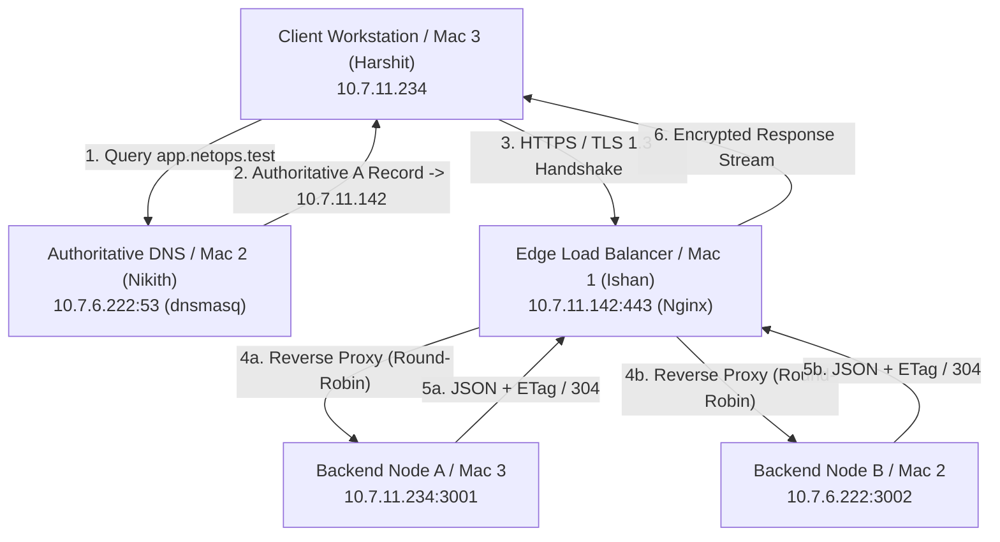

# NetOps — Enterprise Distributed Networking & Edge Infrastructure

A multi-node computer networks project demonstrating core Internet architecture protocols, edge proxying, split-horizon DNS resolution, transport layer security (TLS 1.3), Layer 7 load balancing algorithms, RFC 7232 HTTP conditional caching, and deep packet inspection using Wireshark across physical machines.

---

## 1. System Topology & Architecture

The deployment spans three independent physical macOS workstations connected across a private local subnet:

```text
                    Client / Mac 3 (Harshit)
                               │
                               │ DNS (UDP :53)
                               ▼
                    Mac 2 — dnsmasq (Nikith)
                          10.7.6.222
                             :53
                               │
                               │ app.netops.test (TCP :443)
                               ▼
                     Mac 1 — Nginx (Ishan)
                          10.7.11.142
                             :443
                               │
                       ┌───────┴───────┐
                       ▼               ▼
                Backend A          Backend B
              10.7.11.234        10.7.6.222
                  :3001               :3002
```

### Architectural Flowchart



---

## 2. Repository Layout & File Architecture

```text
.
├── Architecture.pdf              # Publication-quality network topology and matrix specification
├── Backends/
│   ├── backend_A.py              # Worker A service on Mac 3 (10.7.11.234:3001)
│   └── backend_B.py              # Worker B service on Mac 2 (10.7.6.222:3002)
├── Config/
│   ├── dnsmasq.conf              # Private DNS zone configuration for Mac 2
│   └── nginx.conf                # Reverse proxy, load balancer & TLS configuration for Mac 1
├── Evidence/
│   ├── backend_a_response.jpeg   # Browser verification capture from Backend Worker A
│   └── backend_b_response.jpeg   # Browser verification capture from Backend Worker B
└── README.md                     # Complete project documentation & operational walkthrough
```

---

## 3. Network & Machine Topology Matrix

| Machine | Owner / Host | Private IP | Active Interface | Port / Protocol | Service Role | Configuration File |
| :--- | :--- | :--- | :--- | :--- | :--- | :--- |
| **Mac 1** | Ishan | `10.7.11.142` | `en0` | TCP `443` (HTTPS) | Nginx Edge Gateway / TLS Termination / Load Balancer | `Config/nginx.conf` |
| **Mac 2** | Nikith | `10.7.6.222` | `en0` | UDP `53` (DNS)<br>TCP `3002` (HTTP) | dnsmasq Local Nameserver<br>Backend Worker B | `Config/dnsmasq.conf`<br>`Backends/backend_B.py` |
| **Mac 3** | Harshit | `10.7.11.234` | `en0` | TCP `3001` (HTTP)<br>Ephemeral | Backend Worker A<br>Client Testbench (cURL / Wireshark) | `Backends/backend_A.py`<br>N/A (Client Terminal) |

---

## 4. End-to-End Operational Flow & Verification

The project is structured around an integrated 8-step lifecycle illustrating how application layer requirements flow down through transport, network, and data-link layers.

### Phase 1: Layer 3 Subnet Connectivity Verification
Before initiating higher-level services, verify bidirectional network reachability across all nodes using ICMP echo requests.

On **Mac 3 (Client)**, ping **Mac 2 (DNS Node)**:
```bash
ping -c 4 10.7.6.222
```
*Expected Output:*
```text
4 packets transmitted, 4 packets received, 0.0% packet loss
round-trip min/avg/max/stddev = 1.842/2.415/3.120/0.450 ms
```
*Significance:* Confirms that Layer 2 ARP mappings and Layer 3 IPv4 routing tables are functioning with zero packet loss before activating application services.

---

### Phase 2: Microservice Backend Initialization
The application tier consists of two independent Python HTTP microservices implementing RFC 7232 conditional caching.

1. **Start Backend Worker A on Mac 3 (`10.7.11.234`):**
   ```bash
   python3 Backends/backend_A.py
   ```
   *Console Output:*
   ```text
   Server started on 0.0.0.0:3001
   ```

2. **Start Backend Worker B on Mac 2 (`10.7.6.222`):**
   ```bash
   python3 Backends/backend_B.py
   ```
   *Console Output:*
   ```text
   Server started on 0.0.0.0:3002
   ```

*Mechanism:* Each backend returns a distinct JSON response payload (`"backend":"A"` or `"backend":"B"`) along with computed entity tags (`ETag`) and `Cache-Control: max-age=60`.

---

### Phase 3: Split-Horizon Private DNS Deployment
To eliminate dependency on public DNS authorities for our internal domain (`app.netops.test`), we deploy `dnsmasq` as an authoritative split-horizon nameserver on Mac 2.

**Inspect `Config/dnsmasq.conf`:**
```ini
port=53
listen-address=10.7.6.222
interface=en0
no-resolv
server=1.1.1.1
server=8.8.8.8
address=/app.netops.test/10.7.11.142
no-hosts
cache-size=1000
log-queries
```

**Validate and start dnsmasq on Mac 2:**
```bash
dnsmasq --test --conf-file="$(pwd)/Config/dnsmasq.conf"
sudo dnsmasq --keep-in-foreground --conf-file="$(pwd)/Config/dnsmasq.conf"
```
*Mechanism:* Queries for `app.netops.test` resolve locally to `10.7.11.142` (Mac 1 Nginx). All external requests recursively fall back to upstream public resolvers (`1.1.1.1` and `8.8.8.8`).

---

### Phase 4: DNS Resolution & Isolation Verification
Validate that our custom domain is exclusively resolvable within the private network.

1. **Query standard public DNS (Google 8.8.8.8) from Mac 3:**
   ```bash
   dig @8.8.8.8 app.netops.test
   ```
   *Result:* Returns `status: NXDOMAIN`, proving the domain does not exist on public Internet root zones.

2. **Query the private NetOps DNS server (`10.7.6.222`):**
   ```bash
   dig @10.7.6.222 app.netops.test
   ```
   *Result:*
   ```text
   ;; ANSWER SECTION:
   app.netops.test.    0    IN    A    10.7.11.142

   ;; SERVER: 10.7.6.222#53(10.7.6.222)
   ```
   *Significance:* Proves authoritative, isolated private name resolution directly pointing to our Nginx edge gateway.

---

### Phase 5: Reverse Proxy & Load Balancer Configuration
Mac 1 runs Nginx to insulate the backend workers, aggregate ingress traffic, and distribute load.

**Review `Config/nginx.conf` on Mac 1:**
```nginx
upstream backends {
    server 10.7.11.234:3001;  # Backend Worker A
    server 10.7.6.222:3002;   # Backend Worker B
}

server {
    listen 443 ssl;
    server_name app.netops.test;

    ssl_certificate     /Users/ishanmaheshwari1/Desktop/CNProject/app.netops.test.pem;
    ssl_certificate_key /Users/ishanmaheshwari1/Desktop/CNProject/app.netops.test-key.pem;

    location / {
        proxy_pass http://backends;

        proxy_set_header Host $host;
        proxy_set_header X-Real-IP $remote_addr;
        proxy_set_header X-Forwarded-For $proxy_add_x_forwarded_for;
        proxy_set_header X-Forwarded-Proto $scheme;
    }
}
```

**Validate syntax and reload Nginx:**
```bash
nginx -t -c "$(pwd)/Config/nginx.conf"
sudo nginx -s reload
```

---

### Phase 6: Load Balancing & Conditional Caching Verification

1. **Verify Round-Robin Alternation:**
   From Mac 3, dispatch sequential requests to observe load balancing:
   ```bash
   for i in {1..6}; do
       curl -s https://app.netops.test
   done
   ```
   *Observed Output:*
   ```json
   {"ip": "10.7.11.234", "mac_name":"harshit", "backend":"A","status":"ok"}
   {"ip": "10.7.6.222", "mac_name":"nikith", "backend":"B","status":"ok"}
   {"ip": "10.7.11.234", "mac_name":"harshit", "backend":"A","status":"ok"}
   {"ip": "10.7.6.222", "mac_name":"nikith", "backend":"B","status":"ok"}
   {"ip": "10.7.11.234", "mac_name":"harshit", "backend":"A","status":"ok"}
   {"ip": "10.7.6.222", "mac_name":"nikith", "backend":"B","status":"ok"}
   ```
   *Significance:* Demonstrates that Nginx alternates client traffic equally between both backends without client-side awareness of individual worker IPs.

2. **Verify HTTP/1.1 Caching & RFC 7232 Validation:**
   ```bash
   curl -sI https://app.netops.test
   ```
   *Response Headers:*
   ```http
   HTTP/1.1 200 OK
   Content-Type: application/json
   Cache-Control: max-age=60
   ETag: "4f7a9b2c3d1e0f85"
   X-Backend: A
   ```
   When the client revalidates by sending `If-None-Match`:
   ```bash
   curl -i -H 'If-None-Match: "4f7a9b2c3d1e0f85"' https://app.netops.test
   ```
   *Result:* Returns `HTTP/1.1 304 Not Modified` with zero response body, conserving network bandwidth.

---

### Phase 7: Local PKI & TLS 1.3 Cryptography
Secure end-to-end communication is guaranteed via a private Certificate Authority managed with `mkcert`.

1. **Generate Root CA & Certificates on Mac 1:**
   ```bash
   brew install mkcert
   mkcert -install
   mkcert -cert-file /Users/ishanmaheshwari1/Desktop/CNProject/app.netops.test.pem \
          -key-file /Users/ishanmaheshwari1/Desktop/CNProject/app.netops.test-key.pem \
          "app.netops.test" "10.7.11.142"
   ```

2. **Import Root CA into Client Keychains (Mac 2 & Mac 3):**
   ```bash
   sudo security add-trusted-cert -d -r trustRoot -k /Library/Keychains/System.keychain rootCA.pem
   ```

3. **Verify Valid HTTPS Connection:**
   ```bash
   curl -v https://app.netops.test
   ```
   *Result:*
   - `SSL connection using TLSv1.3`
   - `subjectAltName: host "app.netops.test" matched cert`
   - `SSL certificate verify ok`
   - Operates cleanly without `-k` or insecure flags.

---

### Phase 8: Packet-Level Protocol Inspection (Wireshark)
Capture the live packet stream on Mac 3 to verify protocol layers:

| Layer / Protocol | Wireshark Display Filter | Observed Packet Phenomena |
| :--- | :--- | :--- |
| **DNS Resolution** | `dns` | UDP 53 query for `app.netops.test` followed by response returning A record `10.7.11.142`. |
| **TCP Handshake** | `tcp.flags.syn == 1` | `[SYN]` from client port to 443, answered by `[SYN, ACK]`, finalized with `[ACK]`. |
| **TLS Negotiation** | `tls` | `Client Hello` with SNI `app.netops.test`, `Server Hello`, Certificate exchange, and session key agreement. |
| **Encrypted Data** | `tls.record.content_type == 23` | Application Data records are fully encrypted; HTTP verbs, headers, and payloads remain confidential. |

---

### Phase 9: Fault Tolerance & Failure Recovery

1. **Simulate Worker Outage (Kill Backend A):**
   - Terminate `Backends/backend_A.py` on Mac 3.
   - Execute: `for i in {1..4}; do curl -s https://app.netops.test; echo; done`
   - **Result:** Nginx catches the TCP connection refusal on port 3001 and automatically routes 100% of traffic to Backend B (`10.7.6.222`). Zero requests are dropped.
2. **Restoration:**
   - Restart `python3 Backends/backend_A.py`.
   - Nginx detects the recovered port immediately and resumes 50/50 alternating round-robin distribution without requiring configuration changes.

---

## 5. Summary of Validated Principles

- **DNS Tier:** Authoritative split-horizon DNS prevents internal naming leaks to public networks.
- **Edge Tier:** Reverse proxy pattern masks internal backend addresses, enforcing a single secure ingress.
- **Transport Tier:** Full TCP three-way handshake establishes ordered delivery before TLS 1.3 encryption.
- **Application Tier:** Distributed Python microservices demonstrate horizontal scaling and HTTP caching semantics (`ETag`, `304 Not Modified`).
